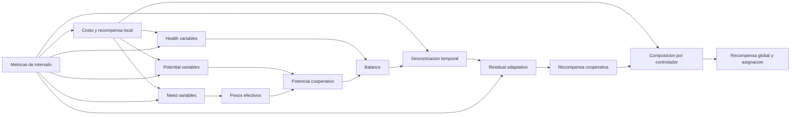

# Guia de configuracion declarativa de la recompensa

## Proposito

Esta guia explica como experimentar con distintas representaciones de recompensa desde `config/config.yaml` sin modificar `RewardCalculator`.

El principio del diseno es:

> [!important]
> La configuracion declara que variables representan cada concepto cientifico. Los nombres de salida permanecen canonicos y son responsabilidad del sistema.

Por tanto, lo configurable no es como se llama `cooperative_potential_01`, sino que metrica se utiliza para construir:

- el potencial cooperativo;
- la necesidad de los pesos adaptativos;
- la salud usada por el balance;
- la alineacion temporal usada por la sincronizacion;
- el peso residual adaptativo.

Estas cinco representaciones pueden usar fuentes diferentes.

## Flujo causal



El orden de ejecucion por intervalo es:

1. `MetricProcessor` calcula las metricas declaradas.
2. Se calculan los costos, salud y recompensas locales.
3. Se recuperan los pesos efectivos derivados de la necesidad del intervalo anterior.
4. Se calcula el potencial base con `potential.variables`.
5. Se aplica el balance con `balance.health_variables`.
6. Se aplica la sincronizacion desde `synchrony.source`.
7. Se calcula el peso residual desde `adaptive_residual.source`.
8. Se transforma el potencial en recompensa cooperativa.
9. Se actualizan las necesidades actuales desde `adaptive_weights.need_variables` para el intervalo siguiente.
10. Se componen y asignan las recompensas finales.

## Dominios semanticos

Cada rama interpreta su `source` de una manera concreta:

| Rama | Dominio | Interpretacion |
|---|---:|---|
| `local.components[].cost` | `[0,1]` | Costo: `0` es mejor y `1` es peor. |
| `potential.variables[].source` | `[0,1]` | Costo en `norm-p` y `geometric_consensus`; salud en `concurrent_progress`. |
| `adaptive_weights.need_variables[].source` | `[0,1]` | Costo o necesidad: valores altos demandan mas peso. |
| `balance.health_variables[].source` | `[0,1]` | Salud: `1` es mejor y `0` es peor. |
| `synchrony.source` | `[0,1]` | Alineacion temporal: `1` es evolucion sincronizada. |
| `adaptive_residual.source` | `[0,1]` | Calidad: valores altos aumentan el peso residual segun `gamma`. |

> [!warning]
> La orientacion de `potential.variables[].source` depende del metodo. `concurrent_progress` requiere salud; los otros dos metodos requieren costo.

## Configuracion vigente

La estructura cooperativa actual es:

```yaml
cooperative:
  enabled: true
  reward_mode: absolute
  residual_weight: 0.1

  potential:
    method: concurrent_progress
    p: 1.0
    epsilon_geom_conc: 1.0e-8
    deterioration_order: 2.0
    variables:
      - id: pendulum_angle
        source: local_health_01_pendulum_angle
        weight: 0.6
      - id: cart_position
        source: local_health_01_cart_position
        weight: 0.4

  adaptive_weights:
    enabled: false
    weight_floor: 0.2
    deterioration_weight: 0.2
    smoothing_alpha: 0.0
    need_variables:
      - id: pendulum_angle
        source: local_cost_01_pendulum_angle
      - id: cart_position
        source: local_cost_01_cart_position

  balance:
    enabled: false
    strength: 0.2
    health_variables:
      - id: pendulum_angle
        source: local_health_01_pendulum_angle
      - id: cart_position
        source: local_health_01_cart_position

  synchrony:
    enabled: false
    source: evolution_alignment_01
    strength: 0.2

  adaptive_residual:
    enabled: false
    source: cooperative_potential_01
    residual_weight_min: 0.02
    residual_weight_max: 0.1
    gamma: 2.0
```

Esta declaracion activa la construccion de progreso concurrente sin alterar por defecto el potencial mediante factores opcionales:

- el potencial usa las saludes locales;
- la necesidad adaptativa conserva fuentes de costo independientes;
- el balance queda neutro;
- la sincronizacion queda neutra, aunque su metrica se calcula y persiste;
- el residual adaptativo usa el potencial cooperativo final.

## Recompensa local

La recompensa local ya era declarativa mediante componentes:

```yaml
local:
  controllers:
    - controller: pendulum_angle
      components:
        - cost: cost_01_error_pendulum_angle_operating
          weight: 1.0
        - cost: cost_01_error_pendulum_angle_rms
          weight: 0.0
        - cost: cost_01_derivative_error_pendulum_angle_asinh_rms
          weight: 0.0
```

Para cada controlador:

$$
c_j^{local}=\operatorname{clip}_{[0,1]}
\left(\sum_q w_{j,q}c_{j,q}\right),
$$

$$
h_j^{local}=1-c_j^{local},
$$

$$
r_j^{local}=1-2c_j^{local}.
$$

Los pesos deben ser finitos, no negativos y sumar `1.0` por controlador.

Las salidas son canonicas:

- `local_cost_01_<controller>`;
- `local_health_01_<controller>`;
- `local_reward_signed_<controller>`.

### Cambiar la representacion local

Ejemplo:

```yaml
components:
  - cost: cost_01_error_pendulum_angle_operating
    weight: 0.6
  - cost: cost_01_error_pendulum_angle_rms
    weight: 0.3
  - cost: cost_01_derivative_error_pendulum_angle_asinh_rms
    weight: 0.1
  - cost: cost_01_memory_pendulum_angle
    weight: 0.0
  - cost: cost_01_delta_u_total_abs
    weight: 0.0
```

Esto cambia la recompensa local. No obliga a cambiar la cooperacion, porque cada rama cooperativa declara sus propias fuentes.

## Potencial cooperativo

### `potential.method`

Metodos disponibles:

- `norm-p`;
- `geometric_consensus`;
- `concurrent_progress`.

### `potential.variables`

Cada variable declara:

- `id`: identidad comun que permite relacionarla con necesidad y balance;
- `source`: costo normalizado para `norm-p` y `geometric_consensus`, o salud normalizada para `concurrent_progress`;
- `weight`: peso nominal.

Los pesos nominales deben ser no negativos y sumar `1.0`.

### `norm-p`

$$
c^{coop}=
\left(\sum_i \lambda_i(c_i^{potential})^p\right)^{1/p},
$$

$$
\Phi^{base}=1-c^{coop}.
$$

Con `p: 1.0` se obtiene una media ponderada. Valores mayores de `p` aumentan la influencia relativa de los costos altos.

### `geometric_consensus`

$$
\Phi^{base}=\exp\left(
\sum_i \lambda_i
\log\left(\max(\epsilon,1-c_i^{potential})\right)
\right).
$$

### `concurrent_progress`

Cada fuente es una salud $h_i\in[0,1]$. Entre intervalos consecutivos se calcula:

$$
\delta_i=h_{i,t}-h_{i,t-1},
\qquad
P=\prod_i[\delta_i]_+^{\lambda_i},
$$

$$
D=\left(\sum_i\lambda_i[-\delta_i]_+^{q_d}\right)^{1/q_d},
\qquad
q^{CP}=P-D,
$$

$$
\Phi^{base}=\frac{q^{CP}+1}{2}.
$$

`deterioration_order` declara $q_d$. Si alguna variable no mejora, $P=0$. El primer intervalo produce $q^{CP}=0$ y $\Phi^{base}=0.5$.

### Ejemplo: cambiar solo el potencial

```yaml
potential:
  method: norm-p
  p: 2.0
  epsilon_geom_conc: 1.0e-8
  deterioration_order: 2.0
  variables:
    - id: pendulum_angle
      source: cost_01_error_pendulum_angle_rms
      weight: 0.6
    - id: cart_position
      source: cost_01_error_cart_position_rms
      weight: 0.4
```

La necesidad adaptativa, el balance y la sincronizacion continuaran usando sus propias fuentes, sin verse alteradas.

## Pesos adaptativos

### `adaptive_weights.need_variables`

Estas fuentes determinan que variable necesita mas atencion. No tienen que coincidir con los costos usados en el potencial.

Los `id` deben coincidir exactamente con los declarados en `potential.variables`, porque la necesidad de cada identidad modifica su peso dentro del potencial.

La necesidad se calcula como:

$$
d_{i,t}=\max(0,c^{need}_{i,t}-c^{need}_{i,t-1}),
$$

$$
n^{raw}_{i,t}=
\frac{c^{need}_{i,t}+w_d d_{i,t}}{1+w_d}.
$$

El suavizado vigente es:

$$
n_{i,t}=
\begin{cases}
n^{raw}_{i,t}, & \alpha=0, \\
(1-\alpha)n_{i,t-1}+\alpha n^{raw}_{i,t}, & \alpha>0.
\end{cases}
$$

Por tanto, `smoothing_alpha: 0.0` significa sin suavizado.

Los pesos efectivos del intervalo siguiente son:

$$
\lambda^{eff}_{i,t+1}=\lambda_{floor}
+\left(1-N\lambda_{floor}\right)
\frac{n_{i,t}}{\sum_k n_{k,t}}.
$$

Si la necesidad total anterior es cero, se usan pesos uniformes `1/N`.

> [!note]
> Con `adaptive_weights.enabled: true`, los pesos nominales de `potential.variables[].weight` se validan pero no participan en el calculo efectivo. El primer intervalo es uniforme y los siguientes dependen de la necesidad. Con `enabled: false`, se usan directamente los pesos nominales.

Las salidas diagnosticas canonicas son:

- `local_need_01_<id>`;
- `cooperative_weight_effective_<id>`.

### Ejemplo: necesidad basada en deterioro RMS

```yaml
adaptive_weights:
  enabled: true
  weight_floor: 0.2
  deterioration_weight: 0.2
  smoothing_alpha: 0.0
  need_variables:
    - id: pendulum_angle
      source: cost_01_error_pendulum_angle_rms
    - id: cart_position
      source: cost_01_error_cart_position_rms
```

El potencial puede continuar usando `local_cost_01_*` mientras la asignacion adaptativa responde al RMS.

## Balance

### `balance.health_variables`

Estas fuentes se interpretan directamente como salud en `[0,1]` y sus `id` coinciden con `potential.variables` para reutilizar los pesos efectivos. El balance compara las medias geometrica y aritmetica:

$$
G_H=\prod_i h_i^{\lambda_i},
\qquad
A_H=\sum_i\lambda_i h_i,
\qquad
B=\frac{G_H}{A_H}.
$$

Cuando $A_H=0$, se define $B=1$. El factor es $F_B=B^{strength}$ y vale uno si `strength: 0.0` o si el subcomponente esta desactivado.

```yaml
balance:
  enabled: true
  strength: 0.2
  health_variables:
    - id: pendulum_angle
      source: local_health_01_pendulum_angle
    - id: cart_position
      source: local_health_01_cart_position
```

## Sincronizacion temporal

`synchrony` ya no calcula el balance. Consume una unica metrica intervalar normalizada y construye $F_S=S^{strength}$:

```yaml
synchrony:
  enabled: true
  source: evolution_alignment_01
  strength: 0.2
```

La metrica se declara con varias fuentes despues de las metricas que consume:

```yaml
- sources:
    - cost_01_error_pendulum_angle_rms
    - cost_01_error_cart_position_rms
  sample_transform: {method: identity}
  interval_reduce:
    method: oriented_rate_alignment
    objective: minimize
    epsilon: 1.0e-12
  post_transform: {method: none}
  raw_target: raw_evolution_alignment
  scaler: {method: bound, mode: positive, bound: 1.0, clip: true}
  target: evolution_alignment_01
```

`MetricProcessor` conserva por episodio los valores anteriores de todas las fuentes. El primer intervalo produce sincronizacion igual a uno.

## Residual adaptativo

### `adaptive_residual.source`

Esta fuente controla cuanto pesa el residual:

$$
\lambda_r^{eff}=\lambda_{min}
+(\lambda_{max}-\lambda_{min})
(z_t)^{\gamma},
$$

donde `z_t` es `adaptive_residual.source` recortada a `[0,1]`.

La configuracion vigente usa:

```yaml
adaptive_residual:
  enabled: true
  source: cooperative_potential_01
  residual_weight_min: 0.02
  residual_weight_max: 0.1
  gamma: 2.0
```

Puede sustituirse por otra representacion de calidad:

```yaml
adaptive_residual:
  enabled: true
  source: mi_confianza_cooperativa_01
  residual_weight_min: 0.02
  residual_weight_max: 0.1
  gamma: 2.0
```

Valores altos de la fuente acercan el peso a `residual_weight_max`.

## Transformacion de la recompensa cooperativa

`reward_mode` transforma el potencial colectivo final:

| Modo | Formula basica |
|---|---|
| `absolute` | `2 * potential - 1` |
| `progress` | `delta_potential` |
| `progress_residual` | `delta_potential - residual_weight * (1 - potential)` |
| `regime_residual` | Selecciona un modo basico y peso residual segun el regimen. |

El primer intervalo tiene `delta_potential = 0`, porque el potencial anterior se inicializa con el actual.

### Limite actual de `regime_residual`

Los umbrales de regimen se aplican actualmente al potencial cooperativo final. `regime_residual_params.signal` es el nombre canonico donde se registra el indice de regimen; no es una fuente conceptual alternativa.

Si en el futuro el regimen debe depender de otra metrica, esa seria una extension adicional semejante a `adaptive_residual.source`.

## Composicion final

```yaml
composition:
  weights:
    local: 1.0
    cooperative: 0.0
    strategic: 0.0
```

Los pesos deben ser no negativos y sumar `1.0`:

$$
r_j^{controller}=\operatorname{clip}_{[-1,1]}
\left(w_l r_j^{local}+w_c r^{coop}+w_s r^{strategic}\right).
$$

La configuracion actual calcula toda la rama cooperativa, pero `cooperative: 0.0` impide que afecte al aprendizaje. Esto permite observarla antes de incorporarla.

Ejemplo:

```yaml
weights:
  local: 0.7
  cooperative: 0.3
  strategic: 0.0
```

Las salidas canonicas son:

- `reward_controller_<controller>`;
- `reward_global_signed`;
- `global_interval_reward`.

La recompensa global sigue siendo el promedio simple de las recompensas de controlador.

> [!warning]
> La recompensa estrategica no esta implementada. Activarla produce un fallo explicito.

## Asignacion a agentes y bonus terminal

```yaml
assignment: controller_reward
```

| Modo | Asignacion |
|---|---|
| `controller_reward` | Cada agente recibe la recompensa de su controlador. |
| `global_reward` | Todos reciben `reward_global_signed`. |
| `agent_reward` | Reservado y no implementado. |

El bonus terminal se agrega despues de la asignacion. Modifica:

- `reward_agent_<agent_id>`;
- `reward_for_learning_<agent_id>`.

No modifica las recompensas locales, cooperativas, de controlador ni globales.

## Ejemplo completo con representaciones independientes

```yaml
cooperative:
  enabled: true
  reward_mode: progress_residual
  residual_weight: 0.1

  potential:
    method: norm-p
    p: 2.0
    epsilon_geom_conc: 1.0e-8
    deterioration_order: 2.0
    variables:
      - id: pendulum_angle
        source: cost_01_error_pendulum_angle_rms
        weight: 0.6
      - id: cart_position
        source: cost_01_error_cart_position_rms
        weight: 0.4

  adaptive_weights:
    enabled: true
    weight_floor: 0.2
    deterioration_weight: 0.3
    smoothing_alpha: 0.2
    need_variables:
      - id: pendulum_angle
        source: cost_01_delta_error_pendulum_angle
      - id: cart_position
        source: cost_01_delta_error_cart_position

  balance:
    enabled: true
    strength: 0.2
    health_variables:
      - id: pendulum_angle
        source: mi_salud_dinamica_pendulum_01
      - id: cart_position
        source: mi_salud_dinamica_cart_01

  synchrony:
    enabled: true
    source: evolution_alignment_01
    strength: 0.2

  adaptive_residual:
    enabled: true
    source: mi_confianza_cooperativa_01
    residual_weight_min: 0.02
    residual_weight_max: 0.1
    gamma: 2.0
```

En este ejemplo:

- el potencial representa amplitud RMS;
- la atencion adaptativa responde al cambio del error;
- el balance usa una salud dinamica distinta;
- la sincronizacion consume la alineacion de evolucion;
- el residual responde a una metrica de confianza.

## Agregar una nueva identidad cooperativa

Una nueva identidad debe aparecer en las tres listas relacionadas:

```yaml
potential:
  variables:
    - id: actuator
      source: cost_01_u_total_rms
      weight: 0.2

adaptive_weights:
  need_variables:
    - id: actuator
      source: cost_01_delta_u_total_abs

balance:
  health_variables:
    - id: actuator
      source: actuator_health_01
```

Ademas:

- hay que redistribuir todos los pesos nominales para que sumen `1.0`;
- `weight_floor` debe cumplir `weight_floor <= 1/N`;
- los tres conjuntos de `id` deben coincidir exactamente.

El sistema creara automaticamente las salidas canonicas:

- `local_need_01_actuator`;
- `cooperative_weight_effective_actuator`.

Si deben persistirse, hay que agregarlas a `data.output_schema.interval_data`.

## Salidas canonicas cooperativas

Estas senales no se renombran desde `reward`:

| Senal | Significado |
|---|---|
| `cooperative_positive_progress_01` | Progreso positivo concurrente $P$. |
| `cooperative_deterioration_01` | Deterioro cooperativo $D$. |
| `cooperative_progress_signed` | Senal $P-D$ de `concurrent_progress`. |
| `health_delta_signed_<id>` | Cambio intervalar de salud de cada variable. |
| `cooperative_potential_base_01` | Potencial antes de balance y sincronizacion. |
| `health_balance_01` | Relacion entre medias geometrica y aritmetica de salud. |
| `balance_factor_01` | Factor aplicado por balance. |
| `synchrony_factor_01` | Factor temporal aplicado por sincronizacion. |
| `collective_potential_01` | Potencial colectivo final. |
| `cooperative_potential_01` | Potencial cooperativo final usado por consumidores existentes. |
| `cooperative_cost_01` | `1 - cooperative_potential`. |
| `delta_cooperative_potential_signed` | Progreso respecto del intervalo anterior. |
| `residual_weight_effective` | Peso residual utilizado. |
| `cooperative_progress_residual_signed` | Progreso menos residual. |
| `cooperative_reward_signed` | Recompensa cooperativa transformada. |

`collective_potential_01` y `cooperative_potential_01` conservan el mismo valor por compatibilidad semantica con los consumidores actuales.

## Runtime y persistencia

La configuracion de recompensa decide que fuentes se leen, pero no que columnas se guardan.

- `runtime_arrays.py` crea las salidas canonicas.
- `data.output_schema.interval_data` decide cuales se persisten.
- `data_summary` decide cuales se resumen.
- la visualizacion decide cuales se grafican.

Una nueva metrica usada como `source` debe existir antes de `RewardCalculator`. Normalmente se declara en `metrics.interval_metrics`.

## Que puede cambiarse sin modificar Python

- Componentes y pesos del costo local.
- Metodo, `p`, fuentes y pesos del potencial.
- Fuentes de necesidad adaptativa.
- Fuentes de salud de balance.
- Fuente y fuerza de sincronizacion.
- Fuente, limites y `gamma` del residual adaptativo.
- Modo de recompensa cooperativa.
- Pesos de composicion local/cooperativa.
- Asignacion por controlador o global.
- Bonus terminal.

## Que sigue siendo una extension de codigo

- Nuevas formulas de potencial distintas de `norm-p`, `geometric_consensus` y `concurrent_progress`.
- Nuevas formulas de necesidad adaptativa.
- Nuevas formulas de balance o sincronizacion.
- Hacer que `regime_residual` use una fuente distinta del potencial.
- Reducciones globales distintas del promedio.
- Recompensa estrategica.
- Credito fino `agent_reward`.

## Checklist experimental

- [ ] Cada `source` y cada entrada de `sources` existe como senal de intervalo.
- [ ] Cada fuente respeta el dominio y orientacion de su rama.
- [ ] Los pesos locales suman `1.0`.
- [ ] Los pesos del potencial suman `1.0`.
- [ ] Los `id` de potencial, necesidad y balance coinciden exactamente.
- [ ] `weight_floor <= 1/N`.
- [ ] Los pesos de composicion suman `1.0`.
- [ ] Las nuevas metricas que deben guardarse aparecen en `output_schema`.
- [ ] Se ejecuta una corrida corta antes de una campana extensa.

## Documentos relacionados

- [[00_declaracion_descriptiva_general]]
- [[01_declaracion_especifica_sistema]]
- [[02_manifiesto_reglas_codificacion]]
