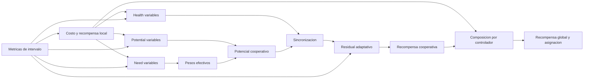

# Guia de configuracion declarativa de la recompensa

## Proposito

Esta guia explica como experimentar con distintas representaciones de recompensa desde `config/config.yaml` sin modificar `RewardCalculator`.

El principio del diseno es:

> [!important]
> La configuracion declara que variables representan cada concepto cientifico. Los nombres de salida permanecen canonicos y son responsabilidad del sistema.

Por tanto, lo configurable no es como se llama `cooperative_potential_01`, sino que metrica se utiliza para construir:

- el potencial cooperativo;
- la necesidad de los pesos adaptativos;
- la salud usada por la sincronizacion;
- el peso residual adaptativo.

Estas cuatro representaciones pueden usar fuentes diferentes.

## Flujo causal



El orden de ejecucion por intervalo es:

1. `MetricProcessor` calcula las metricas declaradas.
2. Se calculan los costos, salud y recompensas locales.
3. Se recuperan los pesos efectivos derivados de la necesidad del intervalo anterior.
4. Se calcula el potencial base con `potential.variables`.
5. Se aplica la sincronizacion con `synchrony.health_variables`.
6. Se calcula el peso residual desde `adaptive_residual.source`.
7. Se transforma el potencial en recompensa cooperativa.
8. Se actualizan las necesidades actuales desde `adaptive_weights.need_variables` para el intervalo siguiente.
9. Se componen y asignan las recompensas finales.

## Dominios semanticos

Cada rama interpreta su `source` de una manera concreta:

| Rama | Dominio | Interpretacion |
|---|---:|---|
| `local.components[].cost` | `[0,1]` | Costo: `0` es mejor y `1` es peor. |
| `potential.variables[].source` | `[0,1]` | Costo cooperativo: `0` es mejor y `1` es peor. |
| `adaptive_weights.need_variables[].source` | `[0,1]` | Costo o necesidad: valores altos demandan mas peso. |
| `synchrony.health_variables[].source` | `[0,1]` | Salud: `1` es mejor y `0` es peor. |
| `adaptive_residual.source` | `[0,1]` | Calidad: valores altos aumentan el peso residual segun `gamma`. |

> [!warning]
> Una salud no debe conectarse directamente como costo del potencial. Tampoco debe conectarse un costo directamente como salud de sincronizacion, salvo que esa inversion semantica sea deliberada.

## Configuracion vigente

La estructura cooperativa actual es:

```yaml
cooperative:
  enabled: true
  reward_mode: absolute
  residual_weight: 0.1

  potential:
    method: norm-p
    p: 1.0
    epsilon_geom_conc: 1.0e-8
    variables:
      - id: pendulum_angle
        source: local_cost_01_pendulum_angle
        weight: 0.6
      - id: cart_position
        source: local_cost_01_cart_position
        weight: 0.4

  adaptive_weights:
    enabled: true
    weight_floor: 0.2
    deterioration_weight: 0.2
    smoothing_alpha: 0.0
    need_variables:
      - id: pendulum_angle
        source: local_cost_01_pendulum_angle
      - id: cart_position
        source: local_cost_01_cart_position

  synchrony:
    enabled: true
    strength: 0.2
    health_variables:
      - id: pendulum_angle
        source: local_health_01_pendulum_angle
      - id: cart_position
        source: local_health_01_cart_position

  adaptive_residual:
    enabled: true
    source: cooperative_potential_01
    residual_weight_min: 0.02
    residual_weight_max: 0.1
    gamma: 2.0
```

Esta declaracion reproduce numericamente el comportamiento previo a la refactorizacion:

- el potencial usa los costos locales;
- la necesidad adaptativa usa esos mismos costos;
- la sincronizacion usa su salud complementaria;
- el residual adaptativo usa el potencial cooperativo final.

La diferencia es que esas coincidencias ahora son explicitas y pueden romperse intencionalmente.

## Recompensa local

La recompensa local ya era declarativa mediante componentes:

```yaml
local:
  controllers:
    - controller: pendulum_angle
      components:
        - cost: cost_01_error_pendulum_angle_operating
          weight: 1.0
        - cost: cost_01_error_pendulum_angle_rms
          weight: 0.0
        - cost: cost_01_derivative_error_pendulum_angle_asinh_rms
          weight: 0.0
```

Para cada controlador:

$$
c_j^{local}=\operatorname{clip}_{[0,1]}
\left(\sum_q w_{j,q}c_{j,q}\right),
$$

$$
h_j^{local}=1-c_j^{local},
$$

$$
r_j^{local}=1-2c_j^{local}.
$$

Los pesos deben ser finitos, no negativos y sumar `1.0` por controlador.

Las salidas son canonicas:

- `local_cost_01_<controller>`;
- `local_health_01_<controller>`;
- `local_reward_signed_<controller>`.

### Cambiar la representacion local

Ejemplo:

```yaml
components:
  - cost: cost_01_error_pendulum_angle_operating
    weight: 0.6
  - cost: cost_01_error_pendulum_angle_rms
    weight: 0.3
  - cost: cost_01_derivative_error_pendulum_angle_asinh_rms
    weight: 0.1
  - cost: cost_01_memory_pendulum_angle
    weight: 0.0
  - cost: cost_01_delta_u_total_abs
    weight: 0.0
```

Esto cambia la recompensa local. No obliga a cambiar la cooperacion, porque cada rama cooperativa declara sus propias fuentes.

## Potencial cooperativo

### `potential.method`

Metodos disponibles:

- `norm-p`;
- `geometric_consensus`.

### `potential.variables`

Cada variable declara:

- `id`: identidad comun que permite relacionarla con necesidad y salud;
- `source`: costo normalizado usado por el potencial;
- `weight`: peso nominal.

Los pesos nominales deben ser no negativos y sumar `1.0`.

### `norm-p`

$$
c^{coop}=
\left(\sum_i \lambda_i(c_i^{potential})^p\right)^{1/p},
$$

$$
\Phi^{base}=1-c^{coop}.
$$

Con `p: 1.0` se obtiene una media ponderada. Valores mayores de `p` aumentan la influencia relativa de los costos altos.

### `geometric_consensus`

$$
\Phi^{base}=\exp\left(
\sum_i \lambda_i
\log\left(\max(\epsilon,1-c_i^{potential})\right)
\right).
$$

### Ejemplo: cambiar solo el potencial

```yaml
potential:
  method: norm-p
  p: 2.0
  epsilon_geom_conc: 1.0e-8
  variables:
    - id: pendulum_angle
      source: cost_01_error_pendulum_angle_rms
      weight: 0.6
    - id: cart_position
      source: cost_01_error_cart_position_rms
      weight: 0.4
```

La necesidad adaptativa y la sincronizacion continuaran usando sus propias fuentes, sin verse alteradas.

## Pesos adaptativos

### `adaptive_weights.need_variables`

Estas fuentes determinan que variable necesita mas atencion. No tienen que coincidir con los costos usados en el potencial.

Los `id` deben coincidir exactamente con los declarados en `potential.variables`, porque la necesidad de cada identidad modifica su peso dentro del potencial.

La necesidad se calcula como:

$$
d_{i,t}=\max(0,c^{need}_{i,t}-c^{need}_{i,t-1}),
$$

$$
n^{raw}_{i,t}=
\frac{c^{need}_{i,t}+w_d d_{i,t}}{1+w_d}.
$$

El suavizado vigente es:

$$
n_{i,t}=
\begin{cases}
n^{raw}_{i,t}, & \alpha=0, \\
(1-\alpha)n_{i,t-1}+\alpha n^{raw}_{i,t}, & \alpha>0.
\end{cases}
$$

Por tanto, `smoothing_alpha: 0.0` significa sin suavizado.

Los pesos efectivos del intervalo siguiente son:

$$
\lambda^{eff}_{i,t+1}=\lambda_{floor}
+\left(1-N\lambda_{floor}\right)
\frac{n_{i,t}}{\sum_k n_{k,t}}.
$$

Si la necesidad total anterior es cero, se usan pesos uniformes `1/N`.

> [!note]
> Con `adaptive_weights.enabled: true`, los pesos nominales de `potential.variables[].weight` se validan pero no participan en el calculo efectivo. El primer intervalo es uniforme y los siguientes dependen de la necesidad. Con `enabled: false`, se usan directamente los pesos nominales.

Las salidas diagnosticas canonicas son:

- `local_need_01_<id>`;
- `cooperative_weight_effective_<id>`.

### Ejemplo: necesidad basada en deterioro RMS

```yaml
adaptive_weights:
  enabled: true
  weight_floor: 0.2
  deterioration_weight: 0.2
  smoothing_alpha: 0.0
  need_variables:
    - id: pendulum_angle
      source: cost_01_error_pendulum_angle_rms
    - id: cart_position
      source: cost_01_error_cart_position_rms
```

El potencial puede continuar usando `local_cost_01_*` mientras la asignacion adaptativa responde al RMS.

## Sincronizacion

### `synchrony.health_variables`

Estas fuentes se interpretan directamente como salud en `[0,1]`:

- `0`: mala salud;
- `1`: buena salud.

Los `id` deben coincidir exactamente con `potential.variables` para aplicar los mismos pesos efectivos.

La salud aritmetica es:

$$
A_t=\sum_i\lambda^{eff}_{i,t}h^{sync}_{i,t}.
$$

Luego:

$$
B_t=\operatorname{clip}_{[0,1]}
\left(\frac{\Phi_t^{base}}{A_t}\right),
$$

$$
S_t=B_t^{strength},
$$

$$
\Phi_t=\Phi_t^{base}S_t.
$$

### Como hacer que `health` sea otra variable

Esta es la rama que debe modificarse:

```yaml
synchrony:
  enabled: true
  strength: 0.2
  health_variables:
    - id: pendulum_angle
      source: mi_salud_pendulum_01
    - id: cart_position
      source: mi_salud_cart_01
```

No es necesario que `mi_salud_*` sea `1 - local_cost`. Puede ser cualquier metrica existente que represente salud en `[0,1]`.

Por ejemplo, una futura metrica puede representar:

- margen respecto de limites fisicos;
- estabilidad conjunta de error y velocidad;
- disponibilidad de esfuerzo de control;
- consenso entre varias condiciones operativas.

El requisito es que la metrica exista antes de evaluar la recompensa y mantenga la orientacion `1 = saludable`.

## Residual adaptativo

### `adaptive_residual.source`

Esta fuente controla cuanto pesa el residual:

$$
\lambda_r^{eff}=\lambda_{min}
+(\lambda_{max}-\lambda_{min})
(z_t)^{\gamma},
$$

donde `z_t` es `adaptive_residual.source` recortada a `[0,1]`.

La configuracion vigente usa:

```yaml
adaptive_residual:
  enabled: true
  source: cooperative_potential_01
  residual_weight_min: 0.02
  residual_weight_max: 0.1
  gamma: 2.0
```

Puede sustituirse por otra representacion de calidad:

```yaml
adaptive_residual:
  enabled: true
  source: mi_confianza_cooperativa_01
  residual_weight_min: 0.02
  residual_weight_max: 0.1
  gamma: 2.0
```

Valores altos de la fuente acercan el peso a `residual_weight_max`.

## Transformacion de la recompensa cooperativa

`reward_mode` transforma el potencial colectivo final:

| Modo | Formula basica |
|---|---|
| `absolute` | `2 * potential - 1` |
| `progress` | `delta_potential` |
| `progress_residual` | `delta_potential - residual_weight * (1 - potential)` |
| `regime_residual` | Selecciona un modo basico y peso residual segun el regimen. |

El primer intervalo tiene `delta_potential = 0`, porque el potencial anterior se inicializa con el actual.

### Limite actual de `regime_residual`

Los umbrales de regimen se aplican actualmente al potencial cooperativo final. `regime_residual_params.signal` es el nombre canonico donde se registra el indice de regimen; no es una fuente conceptual alternativa.

Si en el futuro el regimen debe depender de otra metrica, esa seria una extension adicional semejante a `adaptive_residual.source`.

## Composicion final

```yaml
composition:
  weights:
    local: 1.0
    cooperative: 0.0
    strategic: 0.0
```

Los pesos deben ser no negativos y sumar `1.0`:

$$
r_j^{controller}=\operatorname{clip}_{[-1,1]}
\left(w_l r_j^{local}+w_c r^{coop}+w_s r^{strategic}\right).
$$

La configuracion actual calcula toda la rama cooperativa, pero `cooperative: 0.0` impide que afecte al aprendizaje. Esto permite observarla antes de incorporarla.

Ejemplo:

```yaml
weights:
  local: 0.7
  cooperative: 0.3
  strategic: 0.0
```

Las salidas canonicas son:

- `reward_controller_<controller>`;
- `reward_global_signed`;
- `global_interval_reward`.

La recompensa global sigue siendo el promedio simple de las recompensas de controlador.

> [!warning]
> La recompensa estrategica no esta implementada. Activarla produce un fallo explicito.

## Asignacion a agentes y bonus terminal

```yaml
assignment: controller_reward
```

| Modo | Asignacion |
|---|---|
| `controller_reward` | Cada agente recibe la recompensa de su controlador. |
| `global_reward` | Todos reciben `reward_global_signed`. |
| `agent_reward` | Reservado y no implementado. |

El bonus terminal se agrega despues de la asignacion. Modifica:

- `reward_agent_<agent_id>`;
- `reward_for_learning_<agent_id>`.

No modifica las recompensas locales, cooperativas, de controlador ni globales.

## Ejemplo completo con representaciones independientes

```yaml
cooperative:
  enabled: true
  reward_mode: progress_residual
  residual_weight: 0.1

  potential:
    method: norm-p
    p: 2.0
    epsilon_geom_conc: 1.0e-8
    variables:
      - id: pendulum_angle
        source: cost_01_error_pendulum_angle_rms
        weight: 0.6
      - id: cart_position
        source: cost_01_error_cart_position_rms
        weight: 0.4

  adaptive_weights:
    enabled: true
    weight_floor: 0.2
    deterioration_weight: 0.3
    smoothing_alpha: 0.2
    need_variables:
      - id: pendulum_angle
        source: cost_01_delta_error_pendulum_angle
      - id: cart_position
        source: cost_01_delta_error_cart_position

  synchrony:
    enabled: true
    strength: 0.2
    health_variables:
      - id: pendulum_angle
        source: mi_salud_dinamica_pendulum_01
      - id: cart_position
        source: mi_salud_dinamica_cart_01

  adaptive_residual:
    enabled: true
    source: mi_confianza_cooperativa_01
    residual_weight_min: 0.02
    residual_weight_max: 0.1
    gamma: 2.0
```

En este ejemplo:

- el potencial representa amplitud RMS;
- la atencion adaptativa responde al cambio del error;
- la sincronizacion usa una salud dinamica distinta;
- el residual responde a una metrica de confianza.

## Agregar una nueva identidad cooperativa

Una nueva identidad debe aparecer en las tres listas relacionadas:

```yaml
potential:
  variables:
    - id: actuator
      source: cost_01_u_total_rms
      weight: 0.2

adaptive_weights:
  need_variables:
    - id: actuator
      source: cost_01_delta_u_total_abs

synchrony:
  health_variables:
    - id: actuator
      source: actuator_health_01
```

Ademas:

- hay que redistribuir todos los pesos nominales para que sumen `1.0`;
- `weight_floor` debe cumplir `weight_floor <= 1/N`;
- los tres conjuntos de `id` deben coincidir exactamente.

El sistema creara automaticamente las salidas canonicas:

- `local_need_01_actuator`;
- `cooperative_weight_effective_actuator`.

Si deben persistirse, hay que agregarlas a `data.output_schema.interval_data`.

## Salidas canonicas cooperativas

Estas senales no se renombran desde `reward`:

| Senal | Significado |
|---|---|
| `cooperative_potential_base_01` | Potencial antes de sincronizacion. |
| `synchrony_health_balance_01` | Relacion entre potencial base y salud ponderada. |
| `synchrony_factor_01` | Factor aplicado por sincronizacion. |
| `collective_potential_01` | Potencial colectivo final. |
| `cooperative_potential_01` | Potencial cooperativo final usado por consumidores existentes. |
| `cooperative_cost_01` | `1 - cooperative_potential`. |
| `delta_cooperative_potential_signed` | Progreso respecto del intervalo anterior. |
| `residual_weight_effective` | Peso residual utilizado. |
| `cooperative_progress_residual_signed` | Progreso menos residual. |
| `cooperative_reward_signed` | Recompensa cooperativa transformada. |

`collective_potential_01` y `cooperative_potential_01` conservan el mismo valor por compatibilidad semantica con los consumidores actuales.

## Runtime y persistencia

La configuracion de recompensa decide que fuentes se leen, pero no que columnas se guardan.

- `runtime_arrays.py` crea las salidas canonicas.
- `data.output_schema.interval_data` decide cuales se persisten.
- `data_summary` decide cuales se resumen.
- la visualizacion decide cuales se grafican.

Una nueva metrica usada como `source` debe existir antes de `RewardCalculator`. Normalmente se declara en `metrics.interval_metrics`.

## Que puede cambiarse sin modificar Python

- Componentes y pesos del costo local.
- Metodo, `p`, fuentes y pesos del potencial.
- Fuentes de necesidad adaptativa.
- Fuentes de salud de sincronizacion.
- Fuente, limites y `gamma` del residual adaptativo.
- Modo de recompensa cooperativa.
- Pesos de composicion local/cooperativa.
- Asignacion por controlador o global.
- Bonus terminal.

## Que sigue siendo una extension de codigo

- Nuevas formulas de potencial distintas de `norm-p` y `geometric_consensus`.
- Nuevas formulas de necesidad adaptativa.
- Nuevas formulas de sincronizacion.
- Hacer que `regime_residual` use una fuente distinta del potencial.
- Reducciones globales distintas del promedio.
- Recompensa estrategica.
- Credito fino `agent_reward`.

## Checklist experimental

- [ ] Cada `source` existe como senal de intervalo.
- [ ] Cada fuente respeta el dominio y orientacion de su rama.
- [ ] Los pesos locales suman `1.0`.
- [ ] Los pesos del potencial suman `1.0`.
- [ ] Los `id` de potencial, necesidad y salud coinciden exactamente.
- [ ] `weight_floor <= 1/N`.
- [ ] Los pesos de composicion suman `1.0`.
- [ ] Las nuevas metricas que deben guardarse aparecen en `output_schema`.
- [ ] Se ejecuta una corrida corta antes de una campana extensa.

## Documentos relacionados

- [[00_declaracion_descriptiva_general]]
- [[01_declaracion_especifica_sistema]]
- [[02_manifiesto_reglas_codificacion]]

